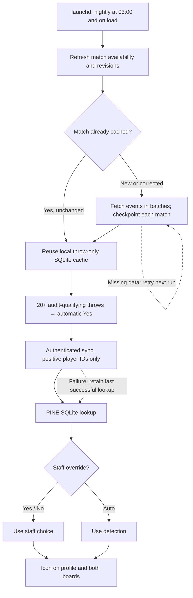
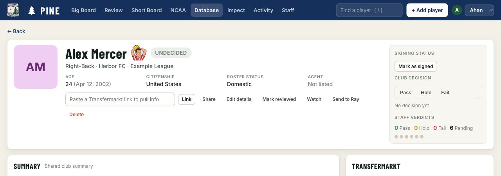
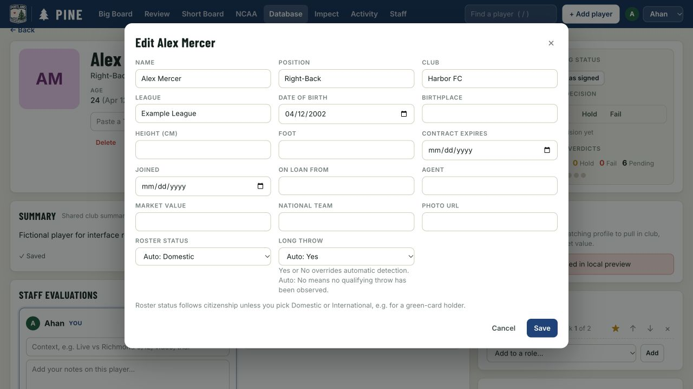
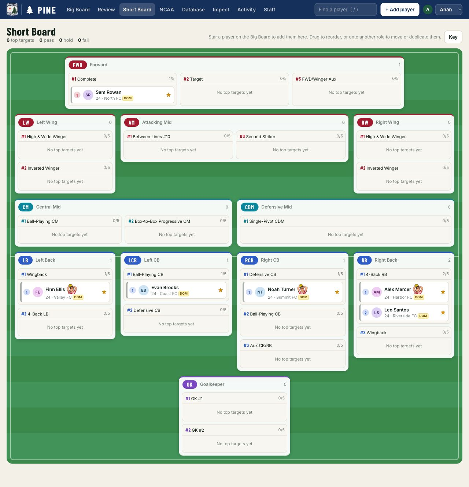
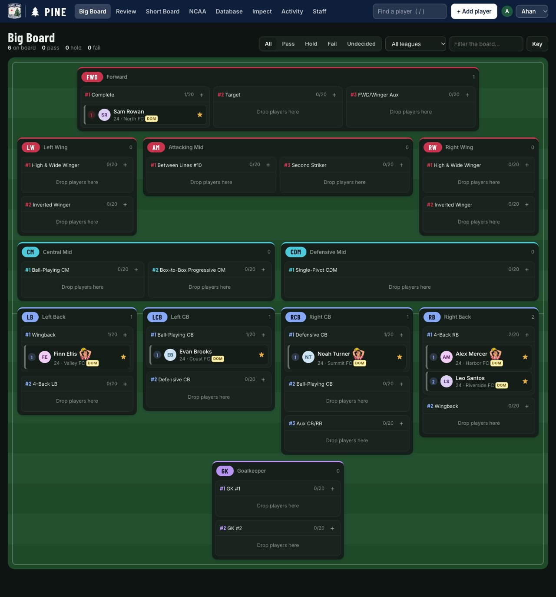
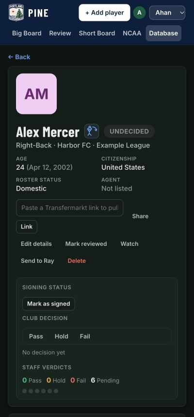
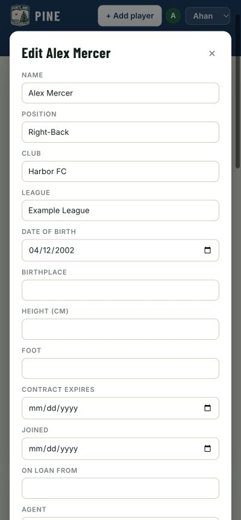
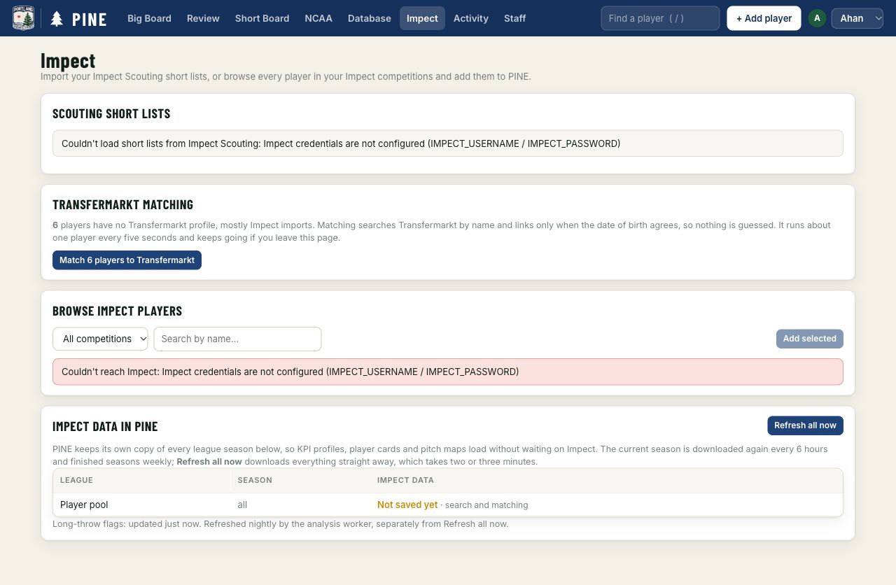

# Long-throw flag

PINE shows a small cartoon Rory Delap for a player known to be capable of a long throw. There are no throw counts, distances, rankings or xG on player pages. The picture sits beside the name, outside the board's collapsing tag row. Its accessible name is “Long throw”; its tooltip also names Rory Delap. [Artwork and generation prompt](long-throw-artwork.md).

Edit details → **Long throw** offers **Auto / Yes / No**, beside roster status. Yes and No always override detection, including for players without Impect coverage. Auto follows the local lookup; Auto: No means no qualifying delivery has been observed. Staff changes are recorded in History and survive syncs, Transfermarkt refreshes, database restarts and supported duplicate merges.

## Detection rule

`long-throw-v2` uses the September Hearts audit's event definition:

- `THROW_IN`, successful or otherwise, forward in attacking coordinates from a touchline into the opponent's penalty area. There is **no distance minimum** or subtype requirement.
- Finite coordinates on the standard 105 × 68 m pitch; start X −52.5–52.5 and within 0.5 m of either touchline; endpoint X 36–52.5 and |Y| ≤20.16; provider endpoint tag `OPPONENT_BOX`; identified thrower and team.
- Duration >0.001 s and distance ≤60 m. Missing coordinates, placeholder durations and extreme distances are withheld, as in the audit.

**Automatic Yes requires at least 20 qualifying throws across covered matches.** The September report already marks fewer than 20 as a small sample. PINE reuses that sample threshold as a conservative automatic-flag policy; the report used it to caution about statistical reliability, not as a validated capability test. No xG or effectiveness criterion enters the flag.

A rare thrower can still be capable. Staff should set **Yes** manually when they know the player has the ability; Auto: No only means the automatic evidence threshold has not been met. The UI remains a binary flag with no counts or analysis. Manual Yes and No always take precedence.

Source: `hearts-of-pine/reports/scouting/long-throws/README.md` (Exact event definition and Attributed xG sample warning) and `analyse.py` (`classify`, `summarise`). Version 1 mixed the older April 25 m threshold with the September geometry and accepted a single event. Version 2 restores the September event definition and applies the conservative sample gate. It does not introduce a new distance cutoff. Ground displacement is not independently measured flight or first-contact distance.

## Nightly update



The sync script runs on the analysis host using Hearts' Python environment and cache-aware adapters. Hearts' `get_events()` does **not** cache events; this script owns a compact, private SQLite cache with match checkpoints and throw-only records. The frozen September audit seeds complete historical matches, including zero-throw matches, without replaying all API requests.

Every online run refreshes the six baseline league-season match lists (a shared list refreshed within 20 hours is reused). When uploading, it also reads PINE's current league-season catalog, so new USL1, USLC and MLSNP seasons are included automatically. Cup competitions are excluded. Newly available matches are fetched first; changed provider revisions and recent matches not checked for seven days are rechecked. Games less than four hours past scheduled kickoff are deferred. The default limit is 150 fetches per run, in batches of ten with a one-second pause. A cold cache or initial catch-up may take multiple runs; `--max-matches` controls that budget.

Empty/omitted event responses and unavailable games remain pending. Provider failures preserve completed local checkpoints and prevent a misleading successful server-sync timestamp. Successful partial coverage reports pending matches in Impect → Impect data in PINE. The same panel marks a sync overdue after 48 hours. Refresh all now refreshes PINE's KPI cache; it does not launch this separate worker.

Every run rebuilds the detected IDs from **all retained cached matches** under the current rule, then uploads the complete derived lookup. Inactivity or unavailable matches do not remove their cached evidence. Corrected events and stricter rules can remove a detection; manual Yes and No are never changed. No historical event download is needed for reclassification.

Worker and server must agree on the rule version. The server atomically replaces the detected lookup and records that version with the sync metadata. It rejects older timestamps, old-rule uploads and reduced cached-match coverage (for example, an accidentally empty cache). A failed upload leaves the last successful lookup intact. Removal-only updates also notify open boards.

Adding or linking a player only queries PINE's indexed Impect-ID lookup. It does not fetch events. The flag tables, overrides and last-sync metadata are included in existing PINE database backups. All raw evidence stays on the analysis host; no player names, staff notes, board state or match-level analysis enter the sync payload.

## Rollout

Both the web deploy and the analysis-host job are needed. For the v2 upgrade, deploy the server and update the existing analysis-host checkout, then run the existing sync job. It reclassifies the retained evidence and atomically replaces the old detected flags. The installed schedule and manual overrides remain in place. The steps below also cover a new installation.

1. Deploy the web change normally. Update the Pine checkout on the analysis host. Use the existing Hearts virtualenv and a private env file containing `PINE_URL` (HTTPS) and the existing `PINE_WORKER_TOKEN`. Impect credentials remain in Hearts' existing environment. No new application dependency is needed.
2. Seed and validate the private cache without provider access or uploads:

   ```bash
   /path/to/hearts-of-pine/venv/bin/python3 scripts/sync-long-throws.py \
     --hop-root /path/to/hearts-of-pine \
     --cache /path/to/pine/data/long-throws.sqlite \
     --bootstrap-audit /path/to/hearts-of-pine/reports/scouting/long-throws \
     --cache-only --output /private/tmp/long-throws.json
   ```

3. Run one online sync; existing checkpoints are reused:

   ```bash
   /path/to/hearts-of-pine/venv/bin/python3 scripts/sync-long-throws.py \
     --hop-root /path/to/hearts-of-pine \
     --cache /path/to/pine/data/long-throws.sqlite \
     --env-file /private/path/pine-worker.env --upload
   ```

4. Preview the scheduler configuration (`--output /private/tmp/long-throws.plist`), then install it with:

   ```bash
   python3 scripts/install-long-throw-sync.py \
     --hop-root /path/to/hearts-of-pine \
     --cache /path/to/pine/data/long-throws.sqlite \
     --env-file /private/path/pine-worker.env --install
   ```

   This loads `com.pine.long-throw-sync` in the current user's launchd domain, runs immediately, and schedules 03:00 local time every day (or `--hour H`). macOS coalesces a missed calendar run at wake; the machine must be awake and online to fetch data. Logs live beside the cache at `long-throw-sync.log`. A file lock prevents overlapping runs. The plist contains paths, not credentials.

5. Verify the sync timestamp in Impect → Impect data in PINE and compare the log's fetched/reused/pending counts on successive runs. Run now with `launchctl kickstart gui/$(id -u)/com.pine.long-throw-sync`. To stop the job, `launchctl bootout gui/$(id -u)/com.pine.long-throw-sync`; the last flags remain available.

The upload route is `PUT /api/worker/long-throws`, protected by `X-PINE: 1` and the worker token. It validates rule version, IDs, timestamps and counts before atomically replacing the detected lookup. Older snapshots and reduced match coverage are rejected; retries are idempotent. The worker refuses redirects, uses HTTPS outside localhost and never logs credentials.

## Validation and visual examples

Automated checks cover audit geometry and quality boundaries, the 19/20 throw threshold, failed throws, no double counting on cache reuse, old-rule reclassification without provider access, both touchlines, disk reuse after reopening, incremental discovery, corrections, missing-data retry, provider failures, bounded batches, audit seeding, atomic rollback, authentication, migrations, manual Yes/No persistence through detection removal, reduced-coverage protection, merges and the real HTTP hydration/board path. Run:

```bash
npm run check
npm test
python3 -m unittest discover -s scripts -p '*_test.py' -v
```

Local validation also imported the complete private audit, performed a bounded two-match Impect fetch, and reran offline against the persisted cache. The generated launchd plist passed `plutil -lint`. These checks do not claim the production scheduler is installed; activation follows the rollout above.

Reproduce the fictional UI examples with `node scripts/preview-long-throws.mjs` and open the printed URL. The preview uses a temporary database, blocks provider access and supports `?theme=light` / `?theme=dark` by applying the app's existing theme tokens. It never reads the production database. Desktop and 400 px phone layouts were checked for badge visibility and horizontal overflow; manual No and restoring Auto were exercised through the UI.

| Profile | Edit control |
|---|---|
|  |  |





| Phone profile, dark | Phone control, light |
|---|---|
|  |  |


